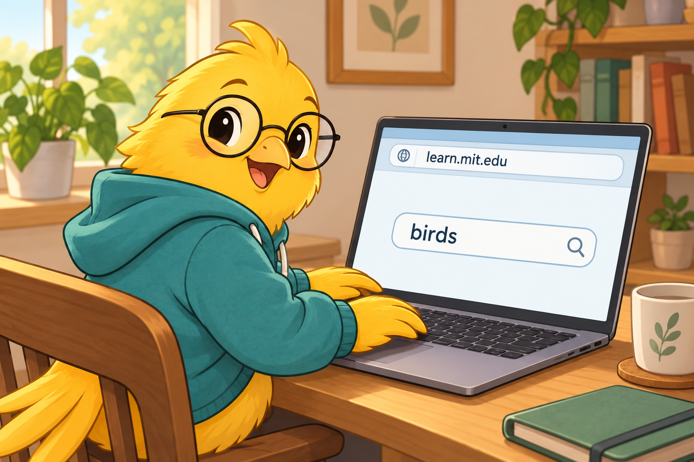
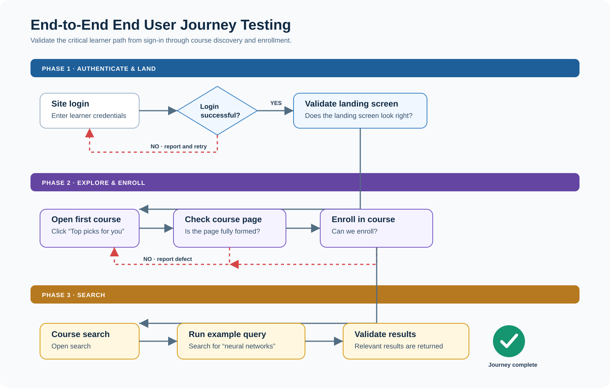
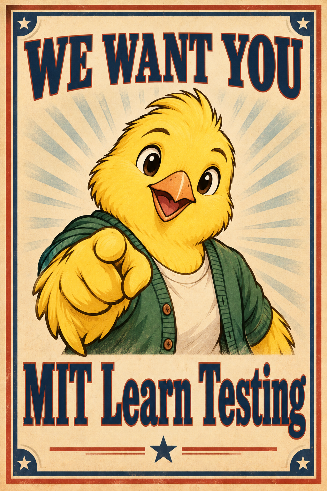
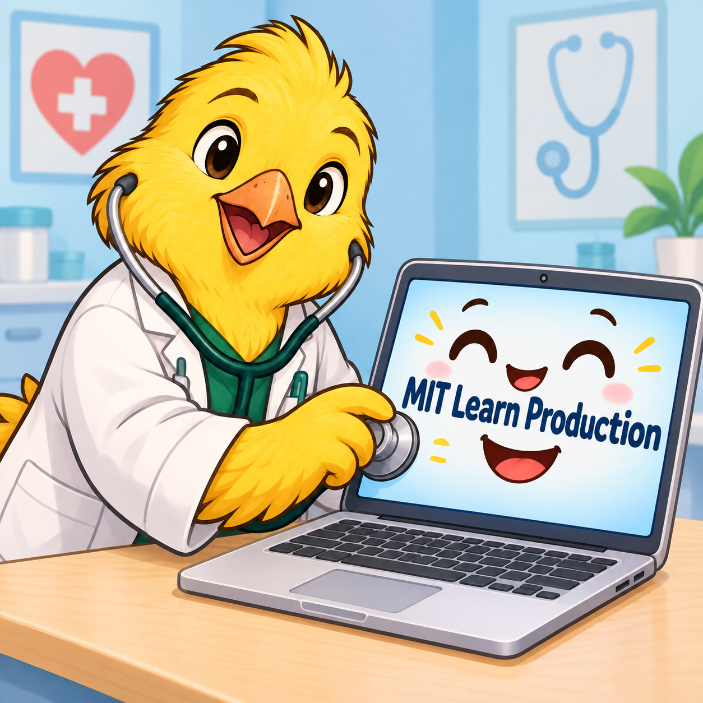

# Canaries: Shipping With Confidence Through End User Testing

# What's in a name? Why "canary"?

Back in the bad old days of coal mining, the legend goes that miners would bring canaries down into the mines with them.
One of the hazards of that job is invisible pockets of poison gas that could suffocate miners before they knew what had
befallen them. A canary, being much smaller than a human, keels over after a much smaller dose of the gas, and thus
served as a grisly but life saving device helping miners avoid peril.

While we're lucky in that we don't need to fear death by poison gas, running the incredibly complex systems we're
building today have plenty of peril all their own, and canaries can help!

# Canaries Are Programs That Act Like End Users Doing Things Users Do

Much like any other kind of testing, we need to be checking in both directions. From the inside out (unit tests,
infrastructure monitoring and alerting, etc.) and from the outside in! Canaries give us that super power.

# End To End User Journey Testing

There are many ways in which we can leverage canaries to help us ship more confidently, but for the initial wave, we're
using them for end to end "user journey" testing.

Here's a diagram showing a simplified example of part of such a test for MIT Learn:

# What We Have Today

We currently impelemnt our end to end user journey canary using a [Concourse
Pipeline](https://cicd.odl.mit.edu/teams/infrastructure/pipelines/canary-mit-learn).

We also maintain a [Markdown
document](https://github.com/mitodl/ol-infrastructure/blob/main/src/ol_concourse/pipelines/canaries/docs/journeys.md)
that gives you a guided visual walkthrough of what the Canary is doing at each step. Let's take a brief spin through it!

The thing is, what we have is imperfect. It needs a knowledgable human touch to really be the end to end user journey
test we all need it to be! :)

The current set of journeys was derived from OTEL data showing the most common "paths" that users took through our
application.

# Where YOU Come In!

We need folks who really understand the product, its features and the way they come together to help signpost the best
path our user testing journey should take.

# The Future

Right now, we're just using canaries in RC to run checks on our pre-production environment.

But Canaries are more powerful than that.

You wouldn't run the same kind of exhaustive tests in production like we do in RC. 

Production test canaries would need to be designed and implemented carefully to minimize load on our production
infrastructure while still helping alert us when something has gone awry. This could help us find problems with the site
even before our lower level alerts can trigger!

Thanks for your time!
