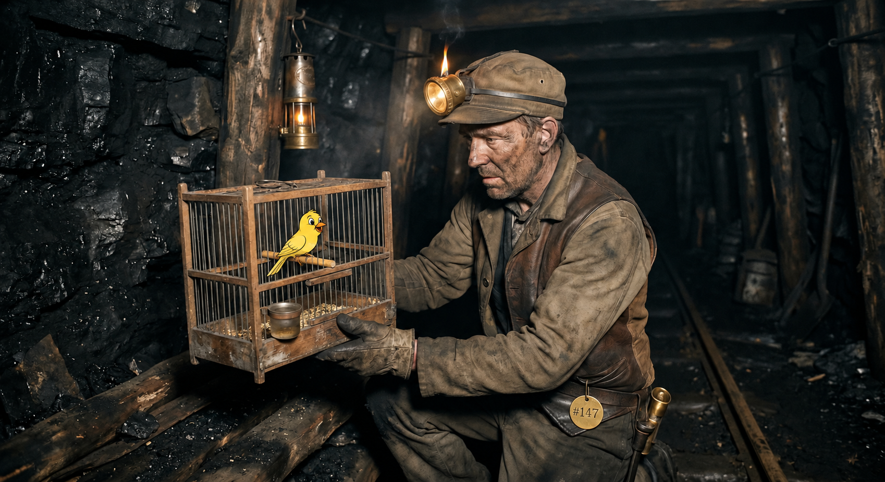

# Canaries: Shipping With Confidence Through End User Testing

---
# What's in a name? Why "canary"?

---
# What's in a name? Why "canary"?

Back in the old days of coal mining, miners would bring canaries down into the mines with them. One of the hazards of that job is invisible pockets of poison gas that could suffocate miners before they knew what had befallen them. A canary, being much smaller than a human, would keel over after a much smaller dose of the gas, and thus served as a grisly but life-saving device helping miners avoid peril.

"Canaries" can also help us avoid perils brought on by the complexity of the systems we build!

---
# Canaries Are Programs That Act Like End Users

Much like any other kind of testing, we need to be checking in both directions. From the inside out (unit tests, infrastructure monitoring and alerting, etc.) and from the outside in! Canaries give us that super power.

---
# End To End User Journey Testing

There are many ways in which we can leverage canaries to help us ship more confidently. Currently, we're using them for end to end user journey testing.

Here's a diagram showing a simplified example of part of such a test for MIT Learn:

---

---
# What We Have Today

We currently implement our end to end user journey canary using a [Concourse Pipeline](https://cicd.odl.mit.edu/teams/infrastructure/pipelines/canary-mit-learn).

We also maintain a [Markdown document](https://github.com/mitodl/ol-infrastructure/blob/main/src/ol_concourse/pipelines/canaries/docs/journeys.md) that gives you a guided visual walkthrough of what the canary is doing at each step. Let's take a brief spin through it!

---
# What We Have Today

What we have is imperfect. It needs a knowledgeable human touch to make the end to end user journey test all we need it to be! :)

The current set of journeys was derived from OTEL data showing the most common "paths" that users took through our application.

---
# Where YOU Come In!

We need folks who really understand the product, its features and the way they come together to identify the best path for our user testing journey.

---
# The Future

Right now, we're just using canaries in RC to run checks on our pre-production environment.

But Canaries are more powerful than that.

You wouldn't run the same kind of exhaustive tests in production like we do in RC.

---
# The Future

Production test canaries would need to be designed and implemented carefully to minimize load on our production infrastructure while still helping alert us when something has gone awry. This could help us find problems with the site even before our lower level alerts can trigger!

Thanks for your time!
